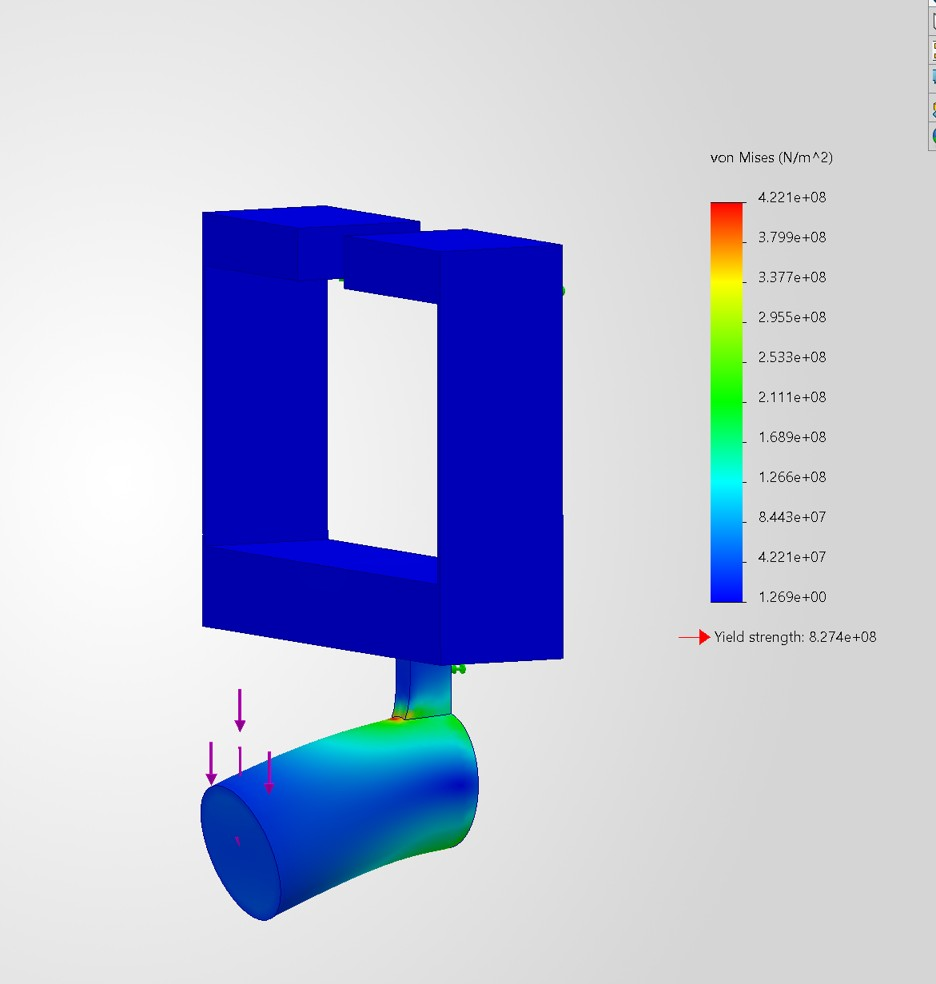
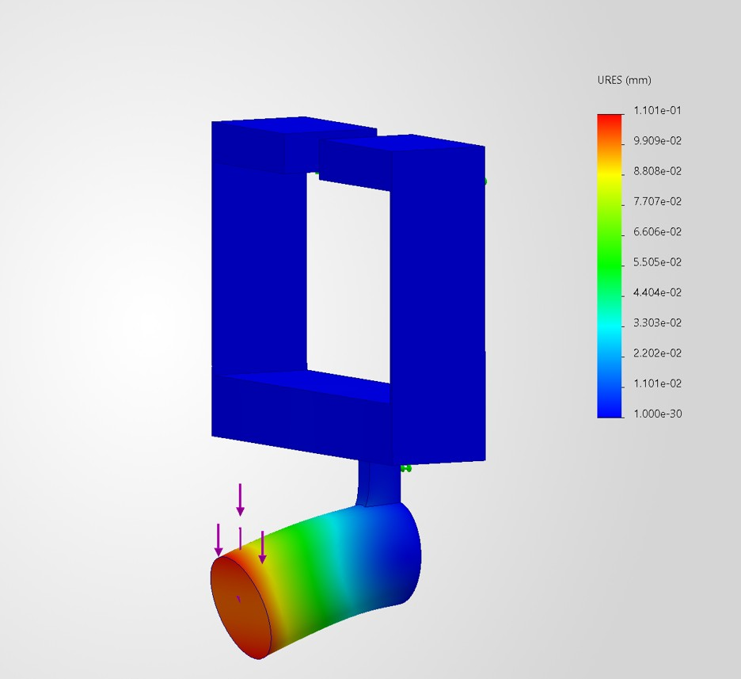
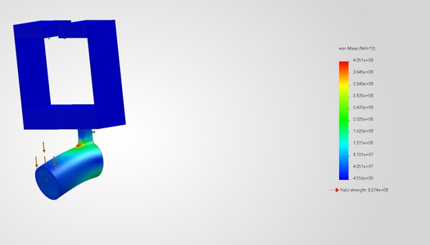
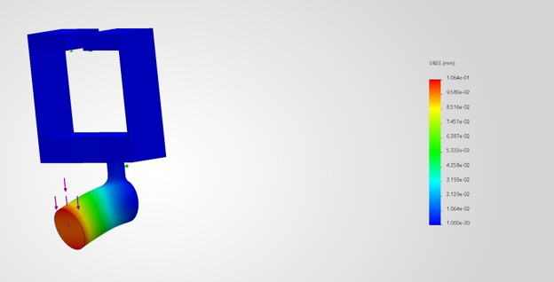
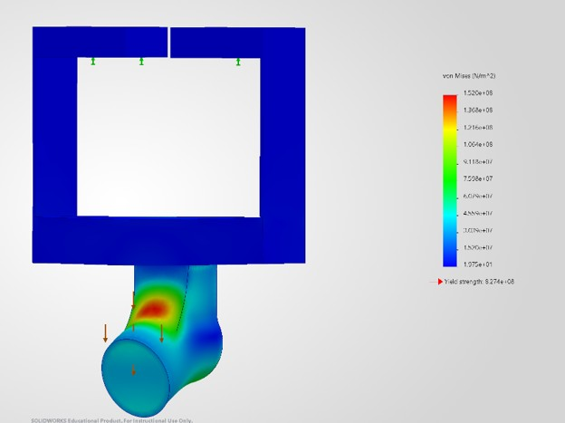
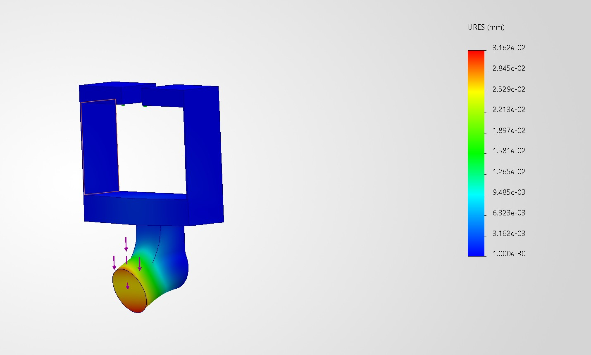
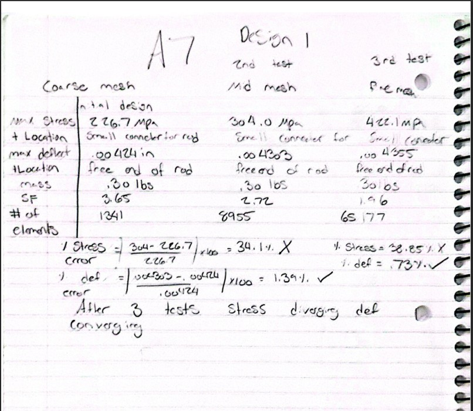
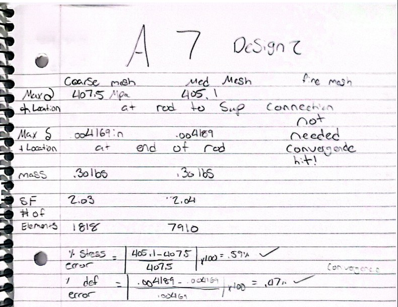
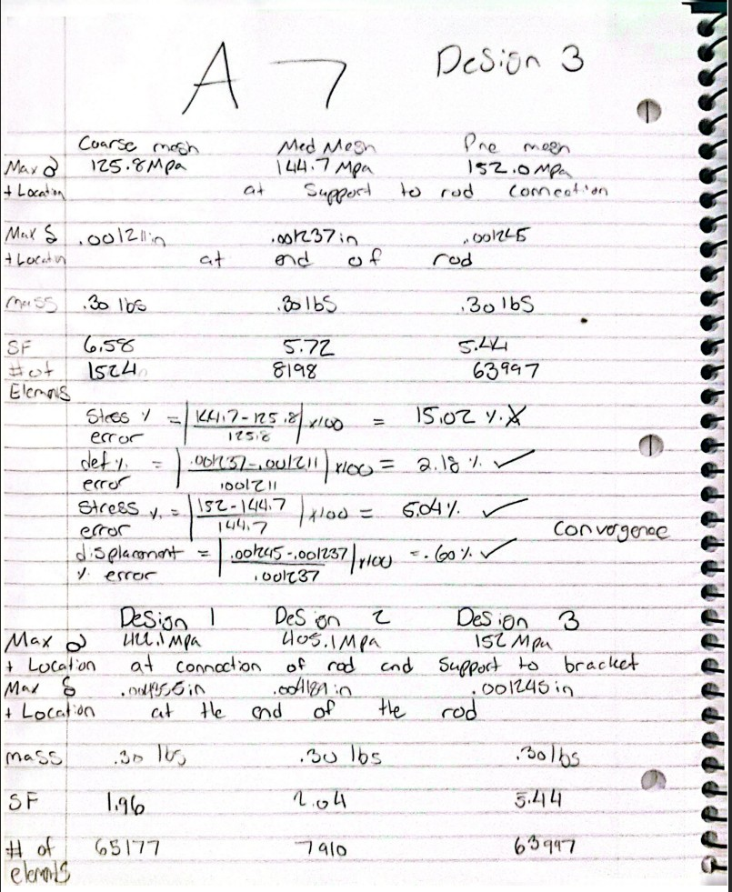

# A7 – Bracket Design and Stress Analysis

## Objective

The objective of this assignment was to design and improve a bracket using SolidWorks and SolidWorks Simulation. The goal was to create a bracket that could support the applied load while meeting the required safety factor of 4. I tested three different designs and compared their stress, displacement, weight, and mesh convergence to determine which design performed the best.

## Analyze

### Design 1 – Original Design

For my first design, I created the original bracket in SolidWorks using titanium as the material. I ran three simulations using coarse, medium, and fine meshes to check the accuracy of my results. The final mesh contained 65,177 elements and showed a maximum stress of 422.1 MPa, a displacement of 0.004335 inches, and a safety factor of 1.96. The bracket weighed approximately 0.30 lbs. Although the displacement was acceptable, the design did not meet the required safety factor of 4, and the stress results did not converge within 7%.

#### Design 1 – Stress Analysis

#### Design 1 – Displacement Analysis

### Design 2 – Adding Fillets

For my second design, I added 0.10-inch fillets to both sides of the connection between the rod and the support to help reduce stress concentration. I tested coarse and medium meshes, with the medium mesh containing 7,910 elements. This design produced a maximum stress of 405.1 MPa, a displacement of 0.004189 inches, and a safety factor of 2.04. The weight remained at approximately 0.30 lbs. While the results successfully converged within 7%, the improvement in strength was small, so I needed to make additional changes.

#### Design 2 – Stress Analysis

#### Design 2 – Displacement Analysis

### Design 3 – Final Design

For my final design, I shortened the rod from 1.25 inches to 1 inch, widened and lengthened the support, and increased the fillet radius to 0.25 inches. These changes were made to strengthen the bracket and reduce bending. After testing three mesh sizes, the fine mesh of 63,997 elements produced a maximum stress of 152.0 MPa, a displacement of 0.001245 inches, and a safety factor of 5.44. The weight stayed at approximately 0.30 lbs. This design met the required safety factor of 4, and both stress and displacement converged within 7%.

#### Design 3 – Stress Analysis

#### Design 3 – Displacement Analysis

## Decide

### Final Design Comparison

| Result | Design 1 | Design 2 | Design 3 |
|---|---|---|---|
| Maximum Stress | 422.1 MPa | 405.1 MPa | 152.0 MPa |
| Maximum Displacement | 0.004335 in | 0.004189 in | 0.001245 in |
| Safety Factor | 1.96 | 2.04 | 5.44 |
| Weight | 0.30 lbs | 0.30 lbs | 0.30 lbs |
| Final Mesh Elements | 65,177 | 7,910 | 63,997 |
| Stress Convergence | Failed | Passed | Passed |
| Required Safety Factor of 4 | Failed | Failed | Passed |

### Final Design Selection

I chose Design 3 as my final design because it had the lowest stress and displacement while meeting the required safety factor of 4. The changes to the rod, support, and fillets made a big improvement compared to the first two designs. It also passed the mesh convergence requirements without increasing the reported weight.

## Communicate

### Mistakes

One of my biggest mistakes was thinking my first design would be strong enough without making many changes. I also thought adding fillets would fix most of the stress problems, but it barely improved the safety factor. Another mistake was trusting the first simulation results too much before checking mesh convergence. I eventually realized I needed to make bigger changes to the bracket to get the results I wanted.

### Lessons Learned

I learned that even small changes to a design can affect how well it performs, but sometimes bigger changes are needed to make a real difference. I also learned how important it is to test different mesh sizes to make sure the results are accurate. Overall, I got more comfortable using SolidWorks Simulation, figuring out where the problems were, and making changes until the design met the requirements.

### Hand Calculations and Tables

The following images show my hand calculations and simulation results for all three designs, including mesh sizes, stress, displacement, safety factors, and convergence calculations.

#### Hand Calculations – Page 1

#### Hand Calculations – Page 2

#### Hand Calculations – Page 3

### Time Spent

The entire assignment took approximately 3 hours, including creating and modifying the three designs, running simulations, checking mesh convergence, and completing the documentation.

### Final CAD File

Below is my final SolidWorks bracket design (Design 3), which achieved a safety factor of 5.44.

**[CLICK HERE TO DOWNLOAD FINAL SOLIDWORKS CAD FILE](https://github.com/rgardn14-max/megr2157-portfolio/raw/refs/heads/main/docs/assignments/A07/Design3.SLDPRT)**
