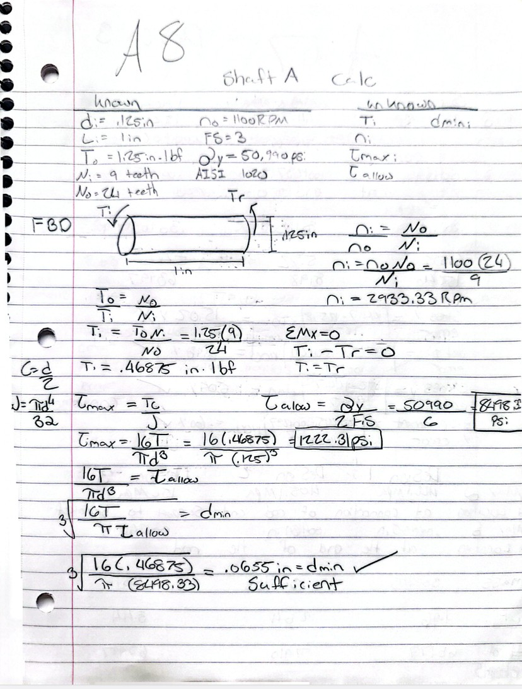
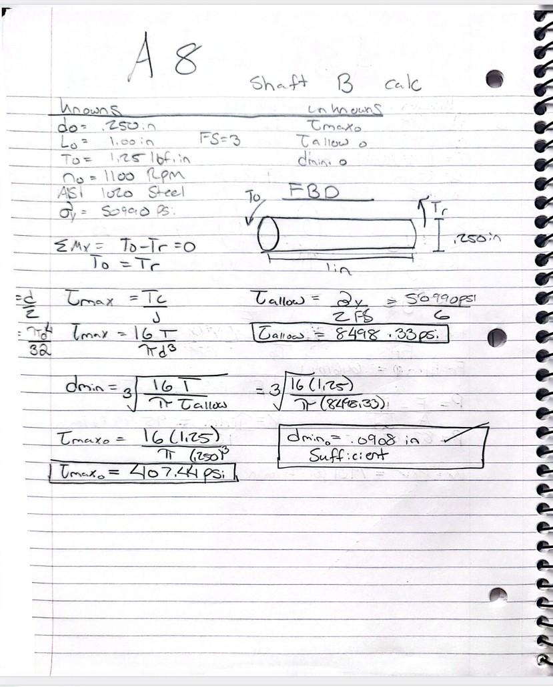
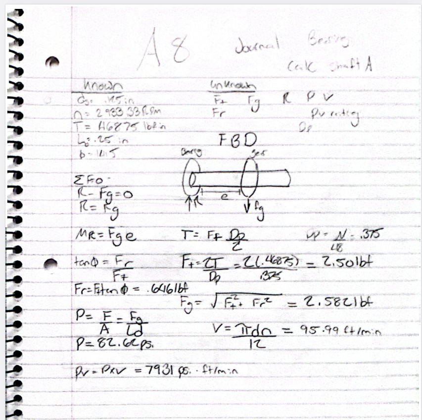
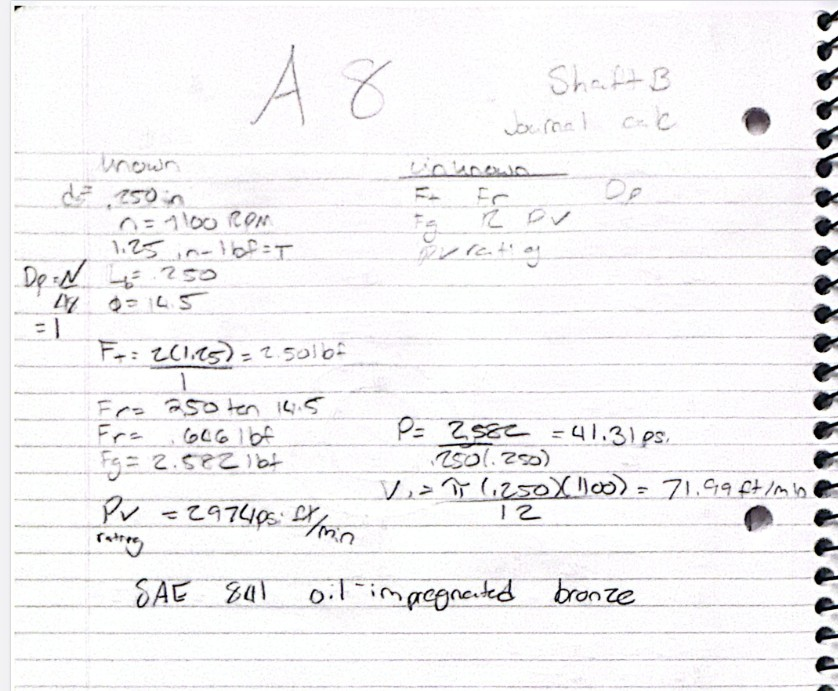
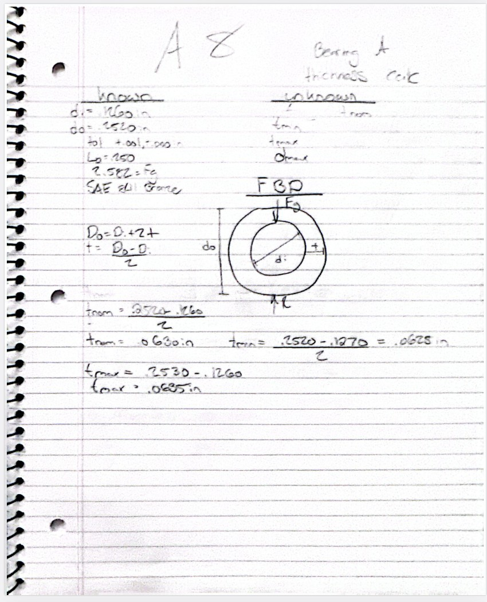
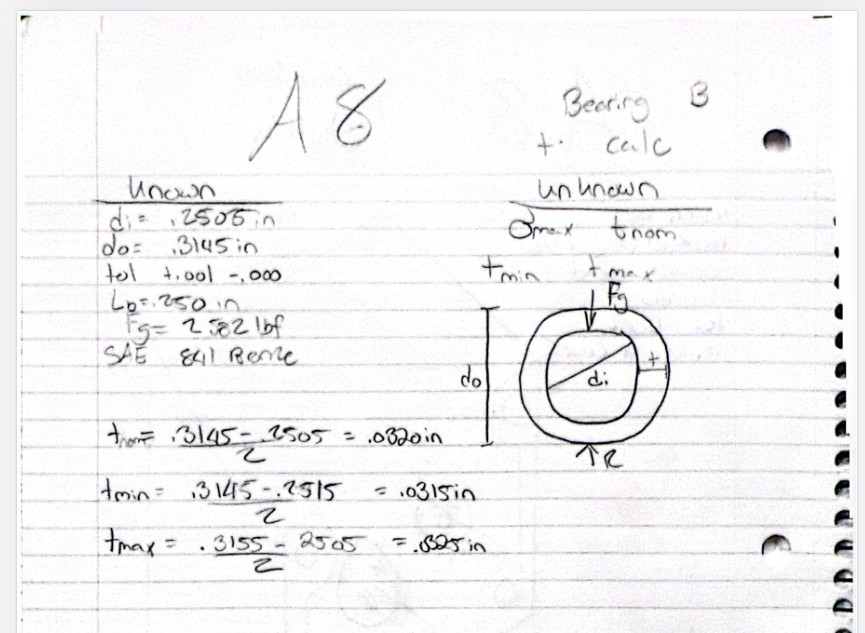
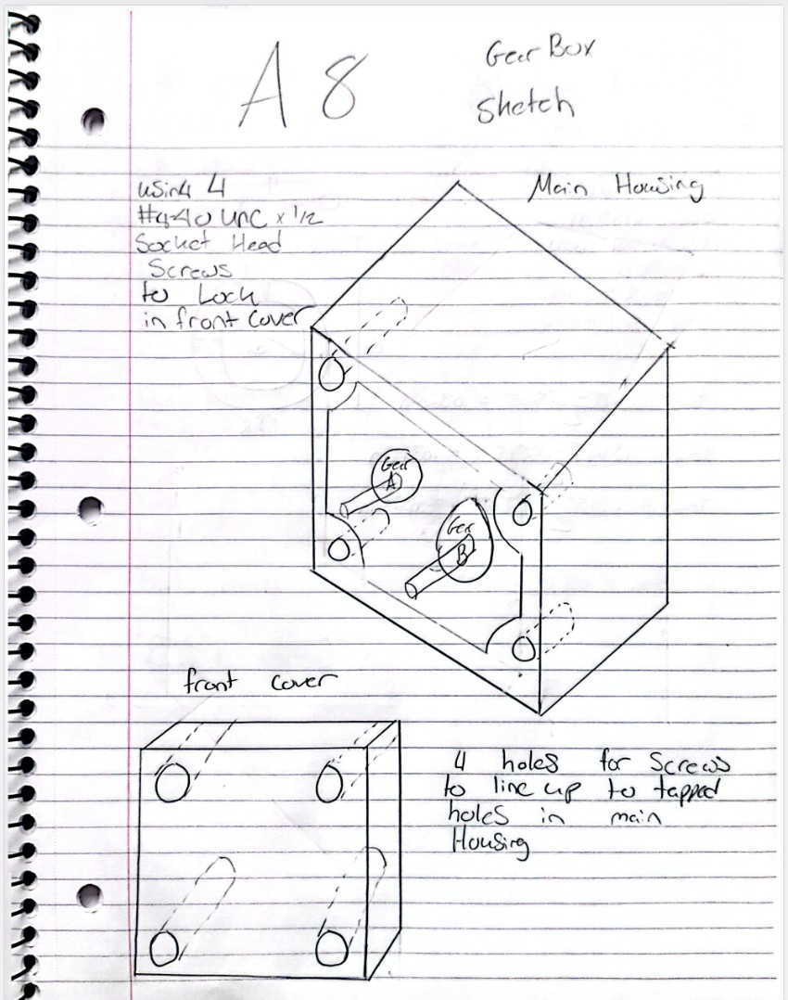
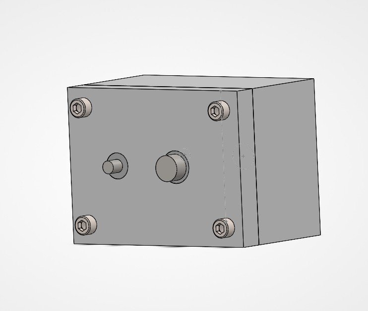
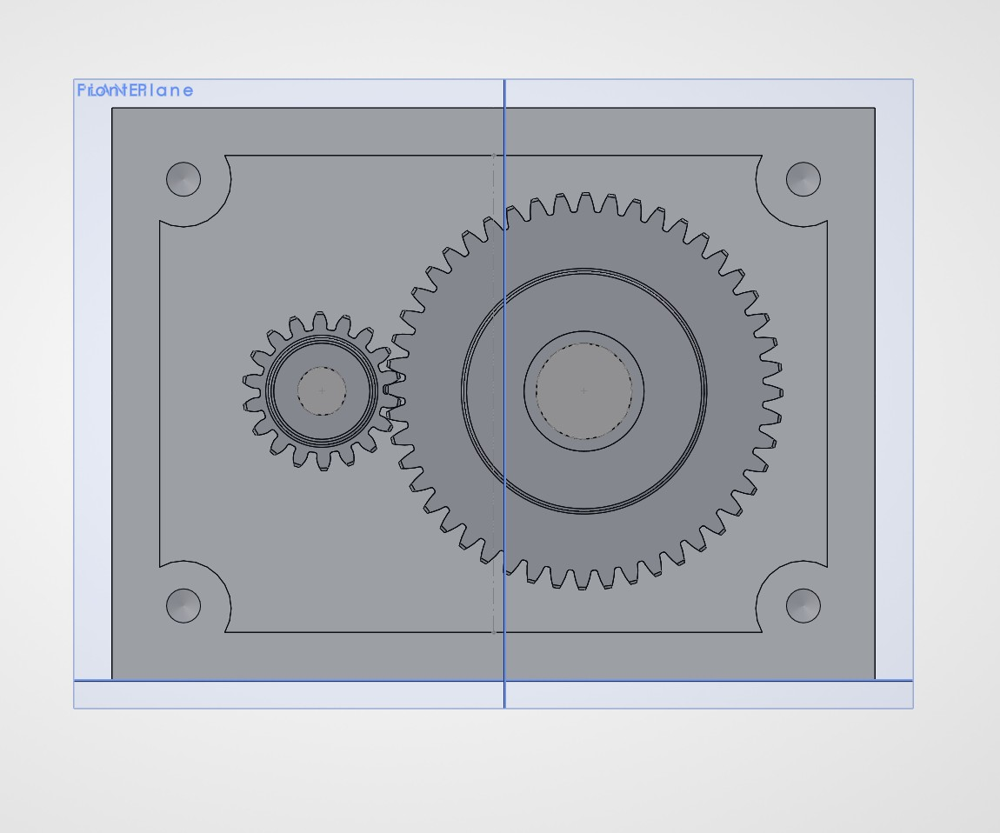
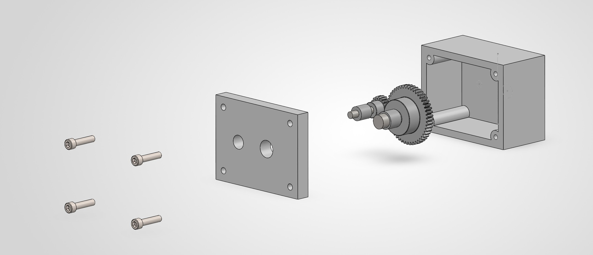

# A8 – Gears

## Objective

The objective of this assignment was to design a two-shaft gearbox using shaft stress calculations, journal bearing analysis, and SolidWorks. The gearbox uses two gears to reduce rotational speed and increase torque. I also designed a two-piece housing that can be taken apart using four screws.

## Analyze

### Part 1 – Shaft Calculations

I started by calculating the stresses in both the input and output shafts to see if their diameters were large enough. I used the torque acting on each shaft and the stress equations from lecture. The input shaft was 0.125 inches in diameter, and the output shaft was 0.250 inches. After comparing the calculated torsional stresses to the allowable stress of AISI 1020 steel, I found that both shafts were sufficient under torsional loading.

#### Input Shaft Calculations

#### Output Shaft Calculations

### Part 2A – Journal Bearing Calculations

For the journal bearings, I decided to use one bearing for each shaft to keep the design simple. I calculated the pressure, velocity, and PV rating for both bearings using the forces acting on the shafts. I chose oil-embedded SAE 841 bronze bearings because they are self-lubricating and work well for this application. Both bearings met the required pressure, velocity, and PV limits.

The bearings I selected were:

- Bearing A: McMaster-Carr 6391K111
- Bearing B: McMaster-Carr 6391K126

#### Bearing A – Pressure, Velocity, and PV Calculations

#### Bearing B – Pressure, Velocity, and PV Calculations

### Part 2B – Journal Bearing Thickness

Next, I worked through the bearing thickness calculations using the equations from lecture. I looked at the stresses acting on each bearing and compared the calculated dimensions with the bearings available from McMaster-Carr. The selected bearings had nominal wall thicknesses of approximately 0.063 inches for Bearing A and 0.032 inches for Bearing B.

#### Bearing A – Thickness Calculations

#### Bearing B – Thickness Calculations

## Decide

### Part 3 – Gearbox Housing Design

I decided to use a simple rectangular housing with a removable front cover. The main housing has 0.125-inch-thick walls, while the front cover is 0.250 inches thick. I used four corner mounting bosses and #4-40 screws to hold everything together while still allowing the gearbox to be opened.

#### Gearbox Housing Sketch

### Part 4 – SolidWorks CAD Assembly

I created the gearbox in SolidWorks using separate parts for the shafts, housing, and other components. I used global variables for important dimensions and downloaded the gears and bearings from McMaster-Carr. After creating the parts, I assembled everything using mates to position the shafts, align the gears, and attach the front cover. I also added four screws and created an exploded view to show how the gearbox comes apart.

#### Final Gearbox Assembly

#### Front View

#### Exploded Gearbox Assembly

## Communicate

### Part 5 – Lessons Learned and Mistakes Made

I learned quite a bit about SolidWorks and how important it is to think about how all the parts will fit together before modeling them. One of my first mistakes was making the housing too deep, which meant the shafts did not extend far enough through the front cover. I had to go back and change the housing dimensions to get everything to fit correctly.

Another problem I had was getting the shafts and gears positioned correctly using mates. Sometimes SolidWorks would show the parts moving into place, but then they would snap back to their original positions. I eventually figured out that adjusting the reference planes helped everything update correctly. I also had trouble with the gears not lining up at first, so I had to go back and adjust their positions.

When I shortened the housing, I accidentally removed the back wall because I forgot to change the depth of the cavity cut. I also learned the difference between clearance holes and threaded holes when adding the screws for the front cover. At first, I was confused about why the threaded holes didn't show actual threads and why the countersinks weren't in the right place.

Overall, this assignment helped me get more comfortable with assemblies, mates, global variables, Hole Wizard, and exploded views in SolidWorks. I also got a better understanding of how shaft and bearing calculations affect the final design. The biggest thing I learned was that changing one dimension can affect several other parts, so it's important to keep checking everything as the model comes together.

### Time Spent

Approximately 7 hours.

### Downloadable CAD File

[Download Complete Gearbox CAD Assembly](A8_Gearbox.zip)
