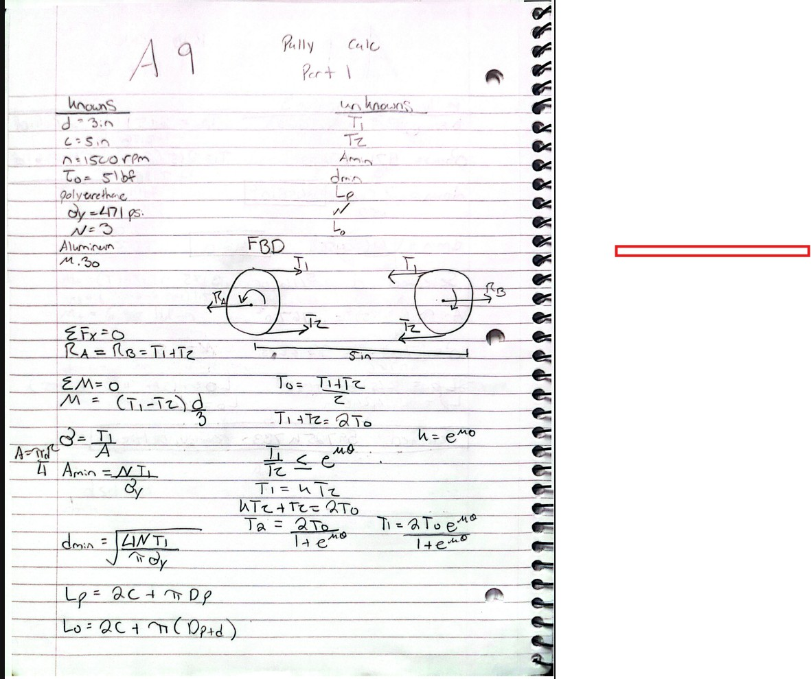
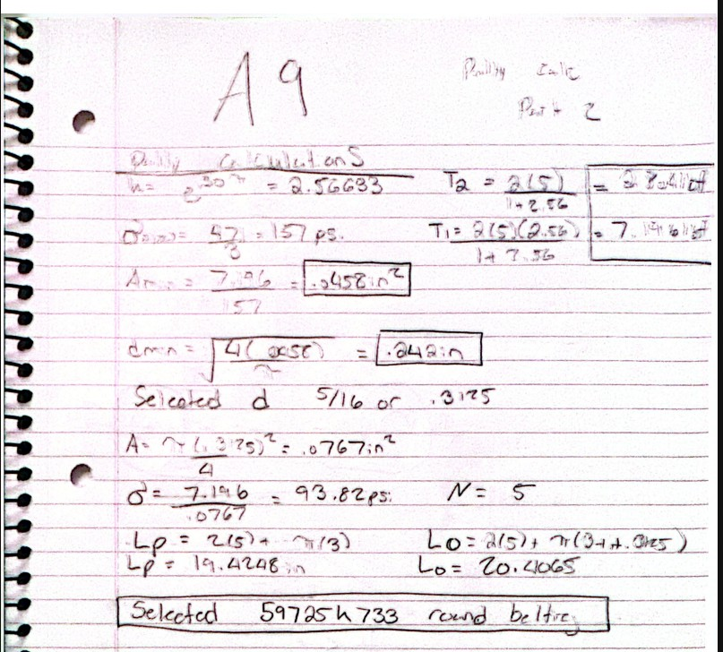
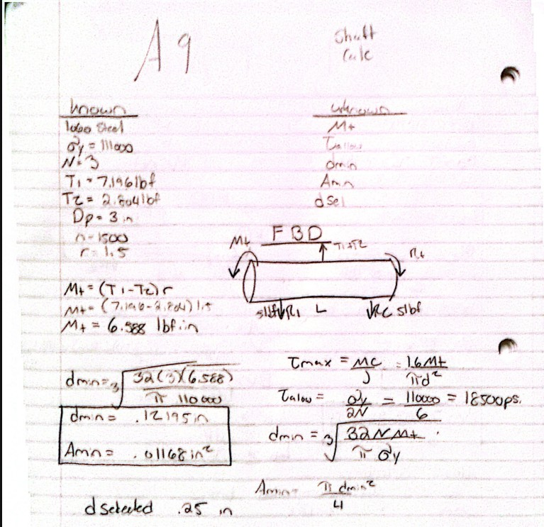
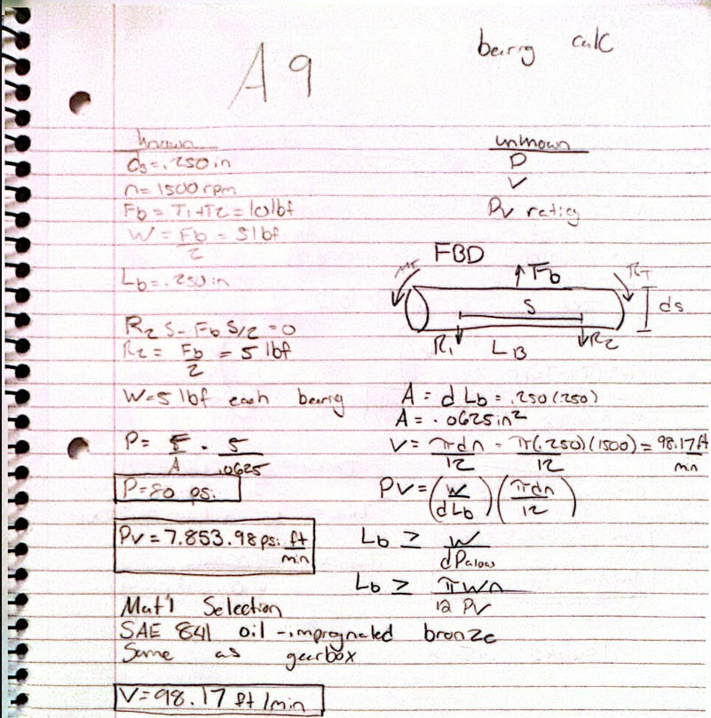
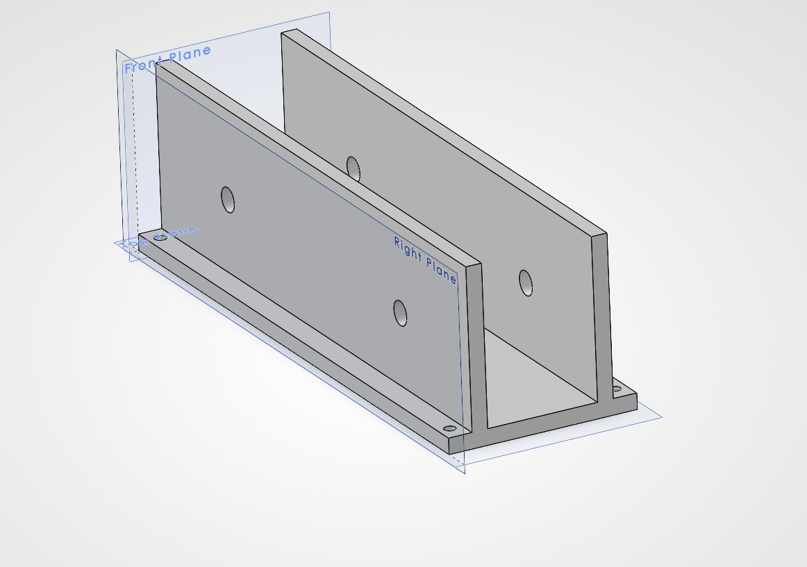
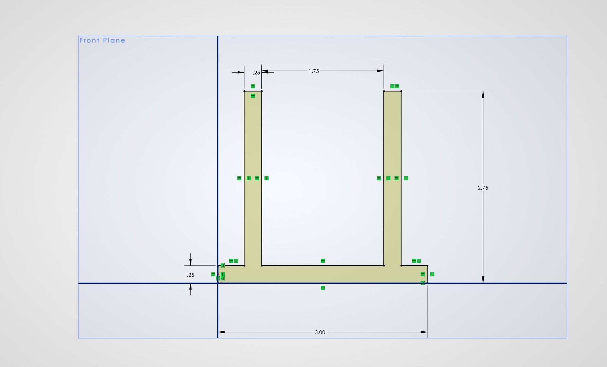

# A9 – Pulleys

## Objective

Design a pulley system to transfer power between two parallel shafts using two 3-inch pulleys. Select a belt, size the shafts and bearings, and design a frame to support the system.

## Analyze

### 1. Belt Selection

I used two 3-inch pulleys spaced 5 inches apart, a speed of 1500 rpm, and an initial belt tension of 5 lbf. Using an assumed friction coefficient of 0.30, I calculated a tight-side tension of 7.196 lbf and a loose-side tension of 2.804 lbf at the slip limit. With a belt yield strength of 471 psi and a safety factor of 3, the minimum area was 0.04583 in² and the minimum diameter was 0.2416 inches. I selected 5/16-inch polyurethane round belting, McMaster-Carr part 59725K733. The selected belt had a calculated tensile safety factor of 5.02 and an installed outer circumference of 20.4065 inches.

### 2. Shaft Design

Using the provided 1060 hardened steel, I calculated the minimum shaft size needed to carry the pulley torque. The difference between the belt tensions multiplied by the pulley radius gave a torque of 6.588 lbf·in. Using a yield strength of 111,000 psi and a required safety factor of 3, I calculated an allowable shear stress of 18,500 psi. This gave a minimum shaft diameter of 0.122 inches and a minimum area of 0.01168 in². I selected a 1/4-inch diameter for both shafts to stay above the calculated minimum.

### 3. Journal Bearing Design

I used two bearings per shaft, with the pulley centered between them so each bearing supported 5 lbf. With a nominal bore and length of 0.250 inches, the bearing pressure was 80 psi. At 1500 rpm, the shaft surface velocity was 98.17 ft/min, giving a PV value of 7,853.98 psi·ft/min. I selected SAE 841 oil-impregnated bronze because it retains oil to lubricate the shaft. The published limits used for comparison were 2,000 psi, 1,200 ft/min, and 50,000 psi·ft/min, all above the calculated values. I selected McMaster-Carr part 6391K131, an oil-embedded SAE 841 bronze sleeve bearing for a 1/4-inch shaft, with a nominal outside diameter of 3/8 inch and a length of 1/4 inch. Four bearings are needed.

## Decide

### 4. Frame Design

I designed an aluminum frame with a base and two upright walls to hold the bearings and keep the shafts lined up. I left room between the walls for the pulleys and belt, with the dimensions shown in my sketch. I also added four mounting holes near the corners of the base so the frame could be secured to a surface.

## Communicate

### 5. Engineering Lessons Learned

I learned why the belt tensions are added to find the bearing load but subtracted to find torque. Both sides pull the pulley toward the other shaft, but they try to turn it in opposite directions. I also learned that choosing a bearing depends on both its load and how fast the shaft turns, which is why we calculate PV.

### Time Spent

3 hours

### Parts and CAD File

[Belt – McMaster-Carr 59725K733](https://www.mcmaster.com/59725K733/)

[Bearings – McMaster-Carr 6391K131](https://www.mcmaster.com/6391K131/)

[Download Frame CAD File](House.SLDPRT)
