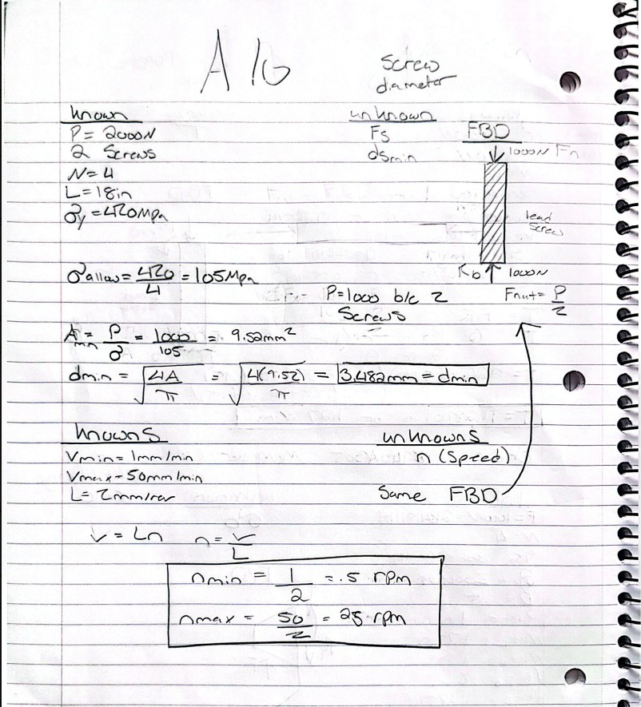
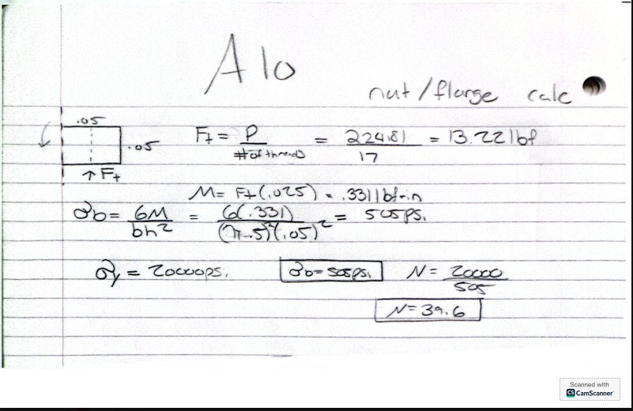
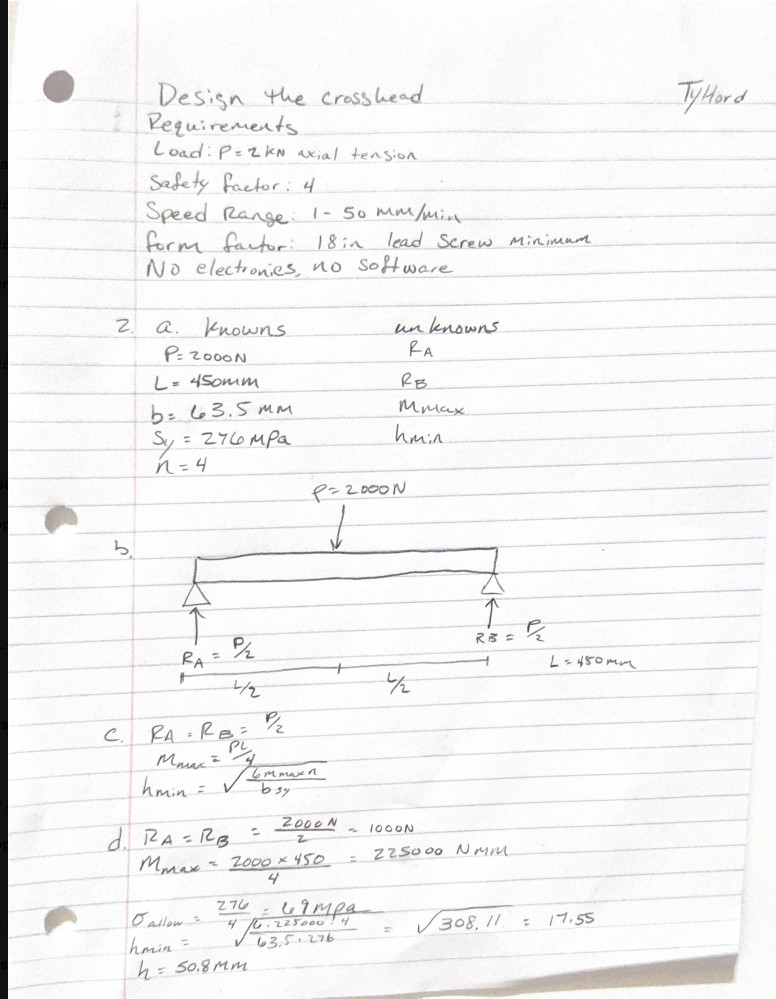
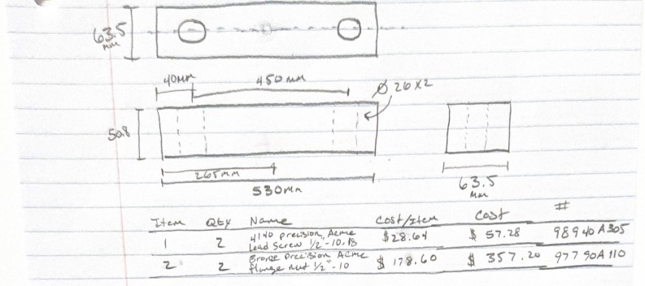

# A10 – Lead Screw Translating System

## Objective

Design a mechanically driven tensile tester that can apply up to 2 kN of tension and move the crosshead at 1–50 mm/min. The design uses two lead screws to share the load and must meet a safety factor of 4 while limiting crosshead deflection to 0.1 mm.

## Analyze

### Lead Screw and Nut Selection — Riley Gardner

For my part of the tensile tester, I chose two 18-inch, 1/2–10 Acme lead screws and matching bronze flange nuts. Since the specimen is centered between the screws, each screw carries half of the 2 kN load, or 1,000 N. Using an assumed steel yield strength of 420 MPa and a safety factor of 4, I calculated a minimum screw root diameter of 3.49 mm. Each turn moves the crosshead 2.54 mm, so the screws need to turn at 0.394–19.69 rpm to cover the required speed range of 1–50 mm/min. Using the equation from class and an assumed friction coefficient of 0.15, I calculated that each screw needs 1.27 N·m of torque at full load. I then modeled the bronze nut threads as small rectangular beams. Assuming 17 threads share the load equally, I got a bending stress of about 505 psi and a safety factor of 39.6, above the required 4.

#### Lead Screw and Nut Calculations

#### Selected Parts

1. [Lead Screw — McMaster-Carr Part 98940A305](https://www.mcmaster.com/98940A305/)
2. [Bronze Flanged Nut — McMaster-Carr Part 97790A110](https://www.mcmaster.com/97790A110/)

### Crosshead Design — [Partner Name]

<!-- Partner paragraph goes here. -->

#### Crosshead Calculations and Sketch

### CAD Assembly and Download

Pending final CAD requirements.

<!-- Add the assembly image and a working download link to the CAD files here. -->

## Decide

<!-- Add the team's Pugh matrix and explain how the selected concept guided the design. -->

## Communicate

### Lessons Learned — Riley Gardner

I learned how to estimate bending stress in a bronze nut thread by treating it as a small rectangular beam. Drawing one thread helped me see how the force from the screw creates a bending moment at the root, where the thread joins the nut. I also learned that the calculated stress depends on how the engaged threads share the load. If one thread carries more than its assumed share, its bending stress will be higher.

### Lessons Learned — [Partner Name]

<!-- Partner's lessons learned paragraph goes here. -->

### Time Spent

<!-- Add each team member's actual time here. -->
