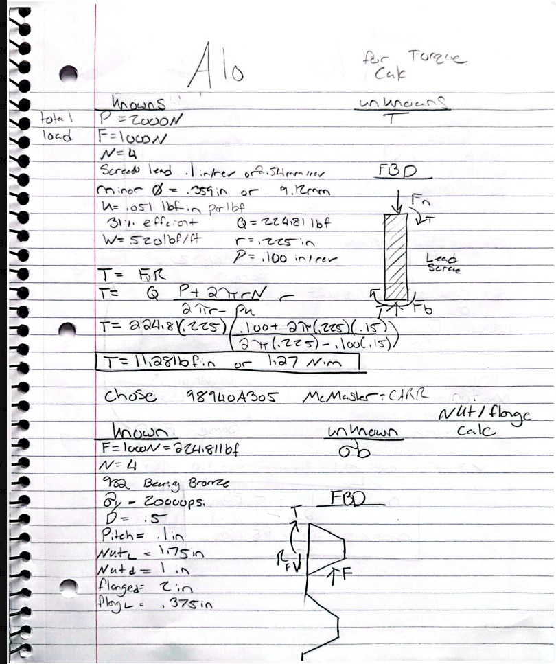
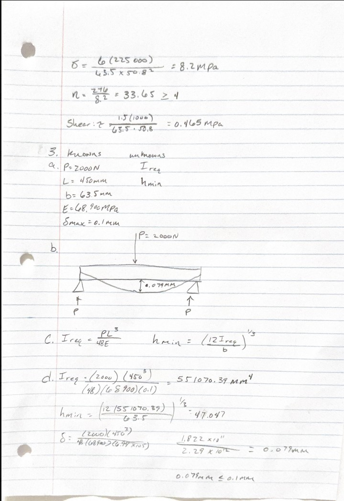
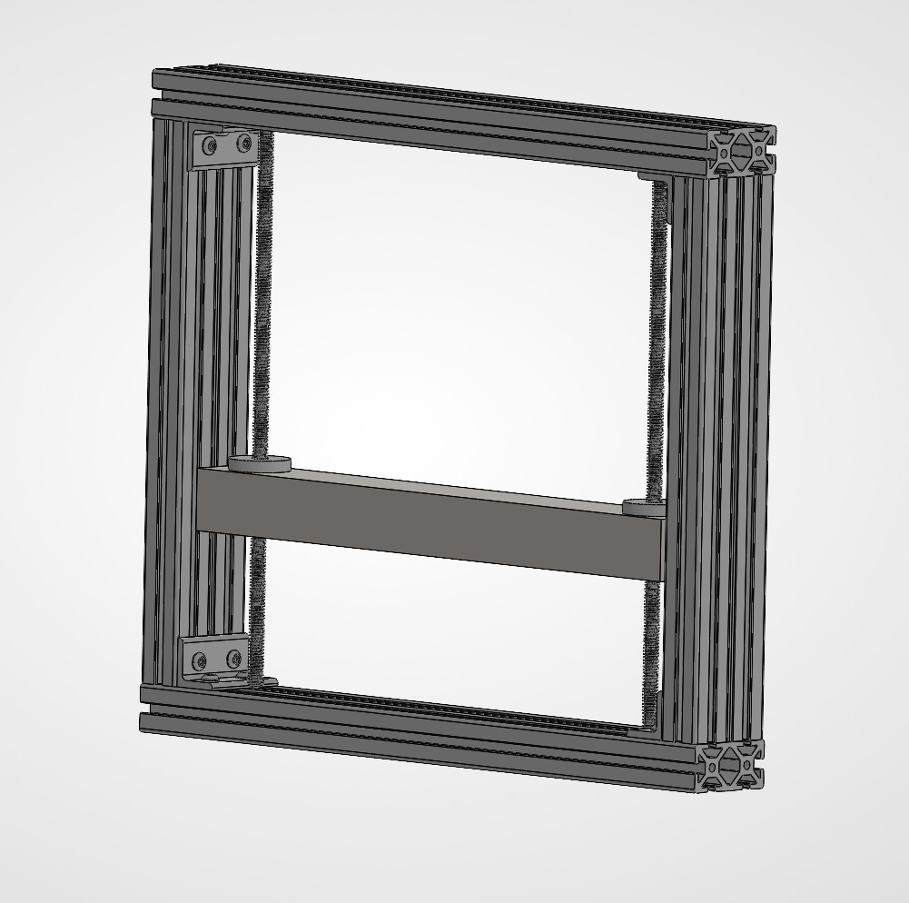

# A10 – Lead Screw Translating System

## Objective

Design a mechanically driven tensile tester that can apply up to 2 kN of tension and move the crosshead at 1–50 mm/min. The design uses two lead screws to share the load and must meet a safety factor of 4 while limiting crosshead deflection to 0.1 mm.

## Analyze

### Lead Screw and Nut Selection — Riley Gardner

For my part of the tensile tester, I chose two 18-inch, 1/2–10 Acme lead screws and matching bronze flange nuts. Since the specimen is centered between the screws, each screw carries half of the 2 kN load, or 1,000 N. Using an assumed steel yield strength of 420 MPa and a safety factor of 4, I calculated a minimum screw root diameter of 3.49 mm. Each turn moves the crosshead 2.54 mm, so the screws need to turn at 0.5–25 rpm to cover the required speed range of 1–50 mm/min. Using the equation from class and an assumed friction coefficient of 0.15, I calculated that each screw needs 1.27 N·m of torque at full load. I then modeled the bronze nut threads as small rectangular beams. Assuming 17 threads share the load equally, I got a bending stress of about 505 psi and a safety factor of 39.6, above the required 4.

#### Lead Screw and Nut Calculations

#### Selected Parts

1. [Lead Screw — McMaster-Carr Part 98940A305](https://www.mcmaster.com/98940A305/)
2. [Bronze Flanged Nut — McMaster-Carr Part 97790A110](https://www.mcmaster.com/97790A110/)

### Design the Crosshead — Ty Hord

I started by listing the knowns and unknowns for the crosshead. I calculated a maximum bending moment of 225,000 N·mm and checked a crosshead height of 50.8 mm. At that height, the calculated safety factor was 33.65, which exceeds the required safety factor of 4.

Next, I checked the crosshead deflection. Using $I_{\mathrm{req}} = PL^3/(48E\delta_{\max})$ with a deflection limit of 0.1 mm, I calculated a required area moment of inertia of 551,070.39 mm⁴. For a rectangular cross section, I used $h_{\min} = (12I_{\mathrm{req}}/b)^{1/3}$ to find a minimum height of 47.047 mm. At the selected height of 50.8 mm, the calculated deflection was 0.079 mm, which is below the 0.1 mm limit.

#### Crosshead Calculations and Sketch

### CAD Assembly - Ben Hackl

I drew the flat profile of the crosshead using the dimensions from our calculations, then extruded it to length. I imported the selected lead screws and flanged nuts, along with the T-slotted framing rails and corner brackets for the frame. Finally, I positioned the parts in the assembly so the lead screws lined up with the flanged nuts on the crosshead.

[Download the A10 Lead Screw Assembly (STEP file)](./A10%20Lead%20Screw%20Assembly.step)

## Communicate

### Lessons Learned

I learned how to estimate bending stress in a bronze nut thread by treating it as a small rectangular beam. Drawing one thread helped me see how the force from the screw creates a bending moment at the root, where the thread joins the nut. I also learned that the calculated stress depends on how the engaged threads share the load. If one thread carries more than its assumed share, its bending stress will be higher.

### Time Spent

2 Hours Riley Gardner
1.5 Hours Ty Hord
1.5 Hours Ben Hackl
